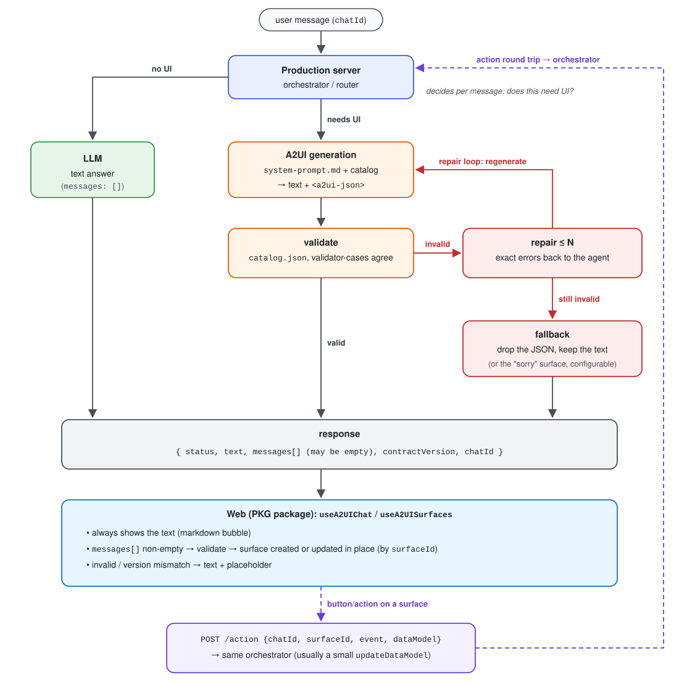

# Orchestrator flow: text always, UI when needed

The owner-approved flow from SV-C26 and SV-C27 in [`docs/server/INTENT.md`](../server/INTENT.md), shown in one diagram.
A production server routes each user message. It either answers with text only, or runs A2UI generation, which is
then validated and repaired (with a fallback if repair fails). Every reply is one response: text plus A2UI messages,
which may be empty. The web package always shows the text and renders surfaces only when there are valid messages. A
button or action on a surface goes back to the same orchestrator. Field details are in
[`handover/SERVER-CONTRACT.md`](../../handover/SERVER-CONTRACT.md).

Status: implemented in PKG part A (`docs/server/reports/info-PKG-A.md`). The reference server has the `[reply]`
modes below (TOML `[reply]`; `ui = "always"`, `fallback = "surface"`, `surfaces = "many"` by default); the web package
`@agentic-ui/a2ui-react` (`packages/a2ui-react`) shows the text of every turn and renders surfaces only for valid
messages. The playground's Integration section shows it running: "Orchestrator (auto UI)" (`/integration/orchestrator`,
PKG part B, `docs/server/reports/info-PKG-B.md`) answers some questions with text only and others with text + a surface.



## ASCII version

```text
 user message (chatId)
        │
        ▼
┌──────────────────────┐
│ Production server    │
│ orchestrator/router  │── decides per message: does this need UI?
└──────────┬───────────┘
     no UI │                  needs UI
   ┌───────┴────────┐     ┌──────────────────────────────────────┐
   ▼                │     ▼                                      │
┌──────────┐        │  ┌─────────────────────────────┐           │
│ LLM:     │        │  │ A2UI generation             │           │
│ text     │        │  │ system-prompt.md + catalog  │           │
│ answer   │        │  │ → text + <a2ui-json>        │           │
└────┬─────┘        │  └──────────────┬──────────────┘           │
     │              │                 ▼                          │
     │              │  ┌─────────────────────────────┐  invalid   │
     │              │  │ validate (catalog.json,     │──────────┐ │
     │              │  │ validator-cases agree)      │          │ │
     │              │  └──────────────┬──────────────┘          ▼ │
     │              │           valid │            repair ≤ N with exact errors
     │              │                 │                         │
     │              │                 │          still invalid  │
     │              │                 │     ┌───────────────────┘
     │              │                 │     ▼
     │              │                 │  fallback: drop the JSON, keep the text
     │              │                 │  (or the "sorry" surface, configurable)
     ▼              │                 ▼     ▼
┌──────────────────────────────────────────────────────────┐
│ response { status, text, messages[] (may be empty),      │
│            contractVersion, chatId }                     │
└──────────────────────────┬───────────────────────────────┘
                           ▼
┌──────────────────────────────────────────────────────────┐
│ Web (PKG package): useA2UIChat / useA2UISurfaces         │
│  • always shows text (markdown bubble)                   │
│  • messages[] non-empty → validate → surface created or  │
│    updated in place (by surfaceId)                       │
│  • invalid / version mismatch → text + placeholder       │
└──────────────────────────┬───────────────────────────────┘
                           │ button/action on a surface
                           ▼
              POST /action {chatId, surfaceId, event, dataModel}
              → same orchestrator (usually a small updateDataModel)
```

## Legend: response fields

| Field             | Meaning                                                                                                                                                                |
| ----------------- | ---------------------------------------------------------------------------------------------------------------------------------------------------------------------- |
| `status`          | `ok` (a valid reply, including a text-only one), `fallback` (UI generation failed after the repairs) or `cancelled`                                                    |
| `text`            | the agent's prose outside the UI block; the web package always renders it as a markdown bubble                                                                         |
| `messages[]`      | A2UI v0.9 messages, always valid for the catalog; **may be empty**: a text-only reply (`messages: []`) is a normal `ok`                                                |
| `contractVersion` | `<catalogId> sha256:<12 hex>` of the catalog the server validates against (DEC-056); a client built for another contract shows a version mismatch instead of rendering |
| `chatId`          | echo of the request's conversation id; one agent session per chat, and surfaces live per chat (updated in place by `surfaceId`)                                        |

## Reference-server modes

| Setting    | Values              | Effect                                                                                                                                                        |
| ---------- | ------------------- | ------------------------------------------------------------------------------------------------------------------------------------------------------------- |
| `ui`       | `always` (default)  | every reply must contain UI; a reply without A2UI messages is repaired                                                                                        |
|            | `auto`              | the agent may answer with text only; the no-UI repair rule applies only when UI was requested                                                                 |
| `fallback` | `text`              | after the repairs fail, the JSON is dropped and the text stays                                                                                                |
|            | `surface` (default) | after the repairs fail, the fixed "sorry" surface ([`handover/fallback.json`](../../handover/fallback.json), retry → `agent.retry`) is returned with the text |
| `surfaces` | `many` (default)    | refinements and actions update the shown `surfaceId`; a new topic gets a new surface (generated prompt rule)                                                  |
|            | `single`            | every reply updates the chat's one surface (the Integration page "Single panel")                                                                              |
